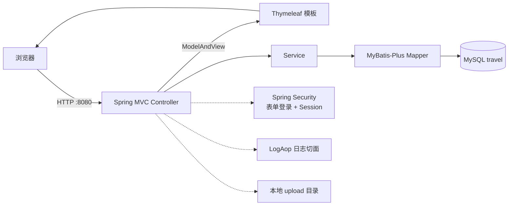
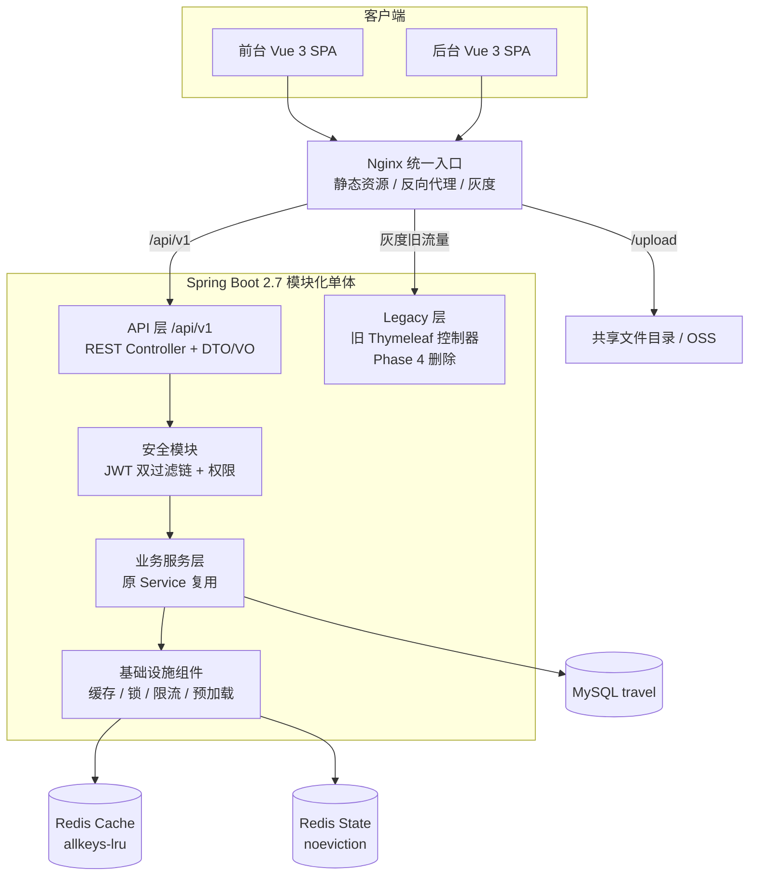
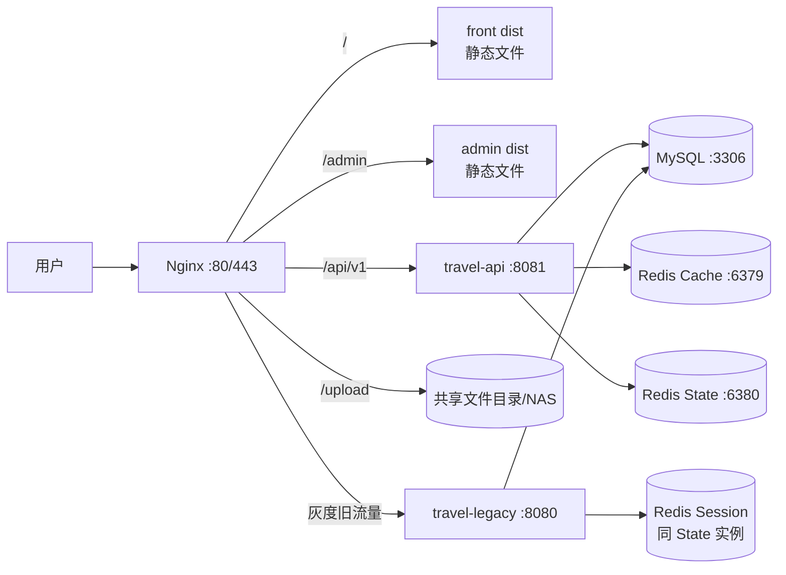
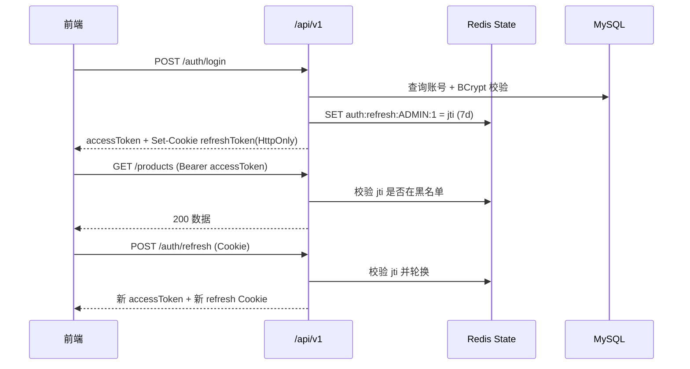
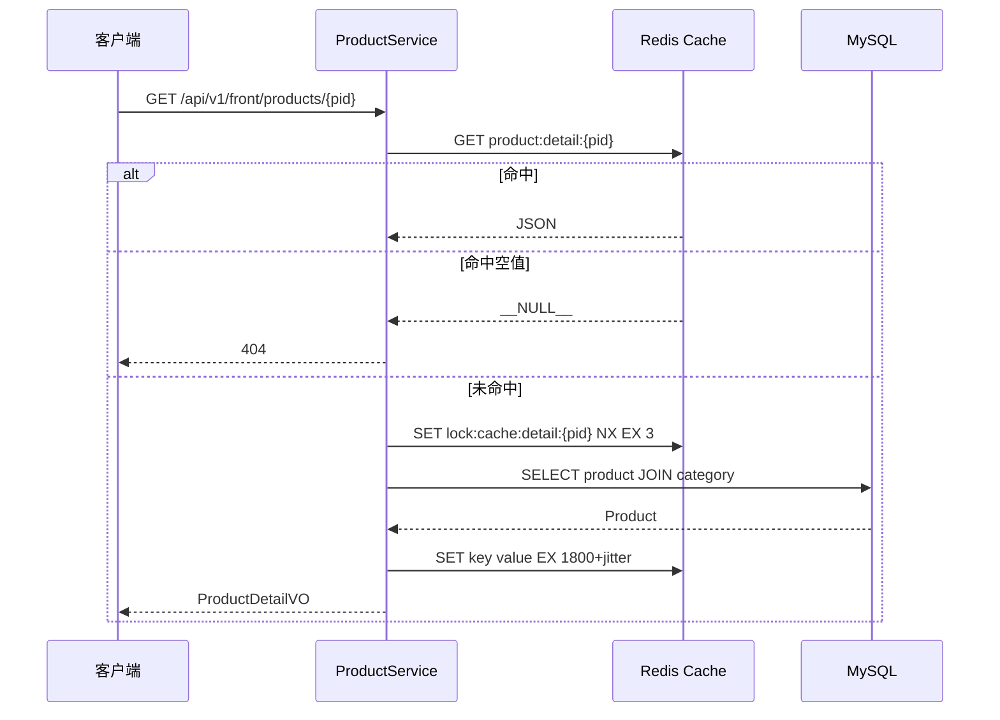
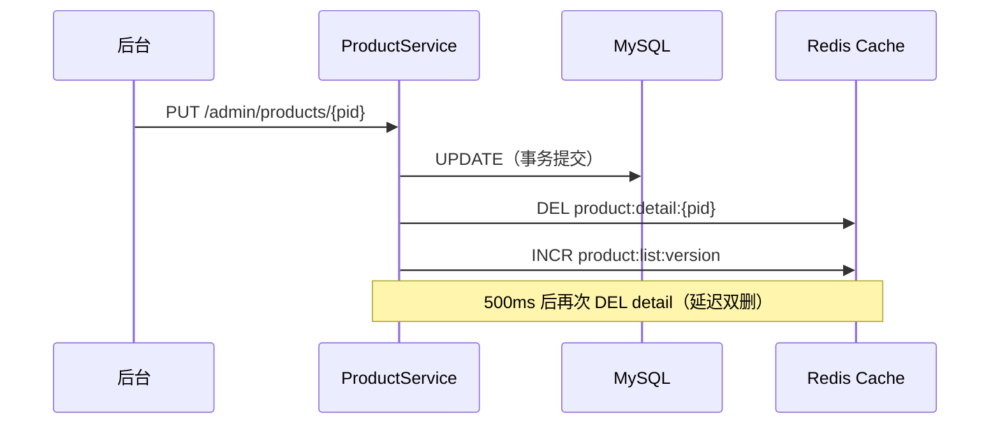

# 去哪旅游网 前后端分离 + Redis 改造技术方案

> 版本：v1.1（已确认，进入实施）  
> 日期：2026-11-10  
> 适用工程：`travel`（Spring Boot 2.7.0 / Java 11 编译目标 / JDK 17 运行 / MySQL / Thymeleaf）  
> 文档状态：**已评审确认，按 Phase 0 → Phase 4 分步实施**

---

## 0. 决策摘要

| 决策项 | 结论 | 关键理由 |
|---|---|---|
| 改造方式 | 渐进式分离，新旧系统并行双跑，Nginx 灰度切流 | 现有系统仍在运行，必须可回滚 |
| 前台前端 | **Vue 3 + Vite 纯 SPA**（不做 Nuxt SSR） | 已确认；部署简单，无 Node SSR 运行时依赖 |
| 后台前端 | Vue 3 + Vite + Element Plus + Pinia（SPA） | 后台无 SEO 诉求，SPA 开发效率高 |
| 后台入口 | 新入口 `/admin`，灰度期保留旧 `/backstage`，全量后 301 | 已确认；双入口保证可回滚 |
| 后端形态 | **模块化单体**，暂不拆微服务 | 当前 6 张核心表、15 个 Controller，拆微服务收益低于运维成本 |
| 接口风格 | REST + JSON，统一前缀 `/api/v1` | 与旧页面路由隔离，便于灰度与回滚 |
| 鉴权 | 前台/后台双域 JWT + Redis 刷新令牌/黑名单 | 替代 Session，支持多实例与主动踢下线 |
| Redis 部署 | 本地 **Docker Compose 双实例**：6379 cache（allkeys-lru）+ 6380 state（noeviction）；生产目标 Sentinel/云 Redis，本期不搭建 | 锁/会话不能被 LRU 淘汰；缓存可以 |
| 运行时版本 | 保持 Spring Boot 2.7.0，**编译目标 Java 11，用本机 JDK 17 运行**；不升级 Boot 3 | 避免 `javax → jakarta` 全量改造 |
| 数据迁移 | 业务数据零迁移，仅做加法式 DDL；切换后首次需重新登录 | 最大程度降低迁移风险 |
| 图片存储 | 继续使用本地共享 `upload` 目录，不上 OSS | 单实例阶段成本最低 |
| 旧系统下线 | 灰度 100% 且稳定观察后再删除 | 保留回滚窗口 |

**已确认的 6 项决策**（原待确认项已全部关闭）：

1. 前台采用 **纯 Vue 3 + Vite SPA**，不做 Nuxt SSR。
2. 后台新入口使用 `/admin`，灰度期保留旧 `/backstage`，全量后 301 跳转。
3. Redis 本地用 Docker Compose 双实例（6379 cache / 6380 state）；生产目标写 Sentinel/云 Redis，本期不搭建。
4. 保持 Spring Boot 2.7.0，编译目标 Java 11，使用本机 JDK 17 运行；不升级 Boot 3。
5. 接受“业务数据零迁移 + 仅加法式 DDL + 切换后首次重新登录”。
6. 图片继续使用本地共享 `upload` 目录，不上 OSS。

---

## 1. 现状梳理与改造边界

### 1.1 现有技术栈与依赖

来源：[pom.xml](file:///d:/JAVAProject/JavaProjects/travel/pom.xml)、[application.yml](file:///d:/JAVAProject/JavaProjects/travel/src/main/resources/application.yml)

| 类别 | 组件 | 版本/说明 | 改造影响 |
|---|---|---|---|
| 运行时 | JDK | 11 | 保持不变，避免 `javax → jakarta` 大改 |
| 框架 | Spring Boot | 2.7.0 | 保持，Phase 4 后再评估升级 |
| Web | spring-boot-starter-web | MVC | 新增 REST API 层，旧 MVC 保留 |
| 模板 | Thymeleaf | 服务端渲染 | 迁移完成后删除 |
| 安全 | Spring Security | 表单登录 + Session + `@PreAuthorize` | 改为 JWT 双过滤链，权限串沿用 |
| ORM | MyBatis-Plus | 3.5.0 | 保持，Service/Mapper 基本复用 |
| 数据库 | MySQL | `travel` 库 | 仅加法式 DDL |
| 其他 | AOP、Mail、Lombok | — | 保留 |
| 构建 | Maven + docker-maven-plugin | — | 增加前端构建与镜像分层 |
| 缺失 | Redis、OpenAPI、参数校验、Actuator | — | 本期补齐 |

### 1.2 模块划分与代码规模

```
src/main/java/com/itbaizhan/travel
├── aop/            操作日志切面（1 个类）
├── bean/           Result、Log、RoleWithStatus、PermissionWithStatus
├── controller/
│   ├── PageController             页面路由入口
│   ├── backstage/                 后台 5 个 Controller
│   └── frontdesk/                 前台 4 个 Controller
├── interceptor/    会员登录拦截器 + MVC 配置
├── mapper/         6 个 Mapper + 4 个 XML
├── pojo/           6 个实体
├── security/       SecurityConfig、UserDetailsService、拒绝处理器
├── service/        7 个 Service
└── util/           验证码 Servlet、邮件工具
```

| 模块 | 现状职责 | 改造后归属 |
|---|---|---|
| 前台展示 | 首页、线路列表/详情、登录注册、收藏 | 新前台（Vue 3 SPA） |
| 后台管理 | 管理员、角色、权限、分类、产品 | 新后台（Vue 3 SPA） |
| 认证授权 | Session + 表单登录 + 权限串 | 新 `travel-security`（JWT） |
| 业务逻辑 | Service 层 | 原样复用，补充缓存/锁/限流 |
| 数据访问 | MyBatis-Plus + XML | 原样复用 |
| 文件上传 | 本地 `upload` 目录 | Nginx 直接托管，后续可迁 OSS |
| 日志 | AOP 打印到日志文件 | 增加 traceId，可选落库 |

### 1.3 现有请求链路



核心事实：

- 后台登录由 [SecurityConfig.java](file:///d:/JAVAProject/JavaProjects/travel/src/main/java/com/itbaizhan/travel/security/SecurityConfig.java#L17-L51) 配置，登录成功 forward 到 `/backstage/index`。
- 权限来自 [MyUserDetailService.java](file:///d:/JAVAProject/JavaProjects/travel/src/main/java/com/itbaizhan/travel/security/MyUserDetailService.java#L26-L54)，权限串即 `permission.permissionDesc`（如 `/admin/all`），方法级通过 `@PreAuthorize` 校验。
- 前台会员登录把 `Member` 放入 `HttpSession`（[MemberController.java](file:///d:/JAVAProject/JavaProjects/travel/src/main/java/com/itbaizhan/travel/controller/frontdesk/MemberController.java#L51-L63)），拦截器从 Session 取值（[MemberInterceptor.java](file:///d:/JAVAProject/JavaProjects/travel/src/main/java/com/itbaizhan/travel/interceptor/MemberInterceptor.java#L9-L18)）。
- 页面路由由 [PageController.java](file:///d:/JAVAProject/JavaProjects/travel/src/main/java/com/itbaizhan/travel/controller/PageController.java#L10-L24) 统一转发模板。
- 验证码由 Servlet 写入 Session（[CheckCodeServlet.java](file:///d:/JAVAProject/JavaProjects/travel/src/main/java/com/itbaizhan/travel/util/CheckCodeServlet.java#L17-L58)）。

### 1.4 现状问题与技术债

| 编号 | 问题 | 位置 | 影响 | 处理阶段 |
|---|---|---|---|---|
| T1 | `@RestController` 返回 `ModelAndView`，注解语义冲突 | [FrontdeskProductController.java](file:///d:/JAVAProject/JavaProjects/travel/src/main/java/com/itbaizhan/travel/controller/frontdesk/FrontdeskProductController.java#L16-L44) | 存在内容协商/渲染异常风险 | Phase 1 拆分时修正 |
| T2 | 全局关闭 CSRF，且无接口级防护 | [SecurityConfig.java](file:///d:/JAVAProject/JavaProjects/travel/src/main/java/com/itbaizhan/travel/security/SecurityConfig.java#L47-L50) | 后台存在 CSRF 风险 | Phase 1 用 SameSite + CSRF Token |
| T3 | 数据库、邮箱口令明文写在配置 | [application.yml](file:///d:/JAVAProject/JavaProjects/travel/src/main/resources/application.yml#L8-L46) | 泄露风险 | Phase 0 改环境变量/密钥管理 |
| T4 | `thymeleaf.cache=false`、SQL 打印到控制台 | [application.yml](file:///d:/JAVAProject/JavaProjects/travel/src/main/resources/application.yml#L20-L33) | 生产性能与日志噪音 | Phase 0 分环境配置 |
| T5 | 收藏表无唯一约束，重复提交会产生重复数据 | [ProductMapper.xml](file:///d:/JAVAProject/JavaProjects/travel/src/main/resources/com/itbaizhan/travel/mapper/ProductMapper.xml#L40-L45) | 数据质量 | Phase 0 增加唯一索引 |
| T6 | 产品/会员/管理员缺少必要索引与唯一约束 | 数据库 | 查询慢、并发重复注册 | Phase 0 在线 DDL |
| T7 | 本地磁盘存储上传文件 | [ProductController.java](file:///d:/JAVAProject/JavaProjects/travel/src/main/java/com/itbaizhan/travel/controller/backstage/ProductController.java#L65-L96) | 多实例部署时文件不一致 | 保留单实例或挂共享存储 |
| T8 | 分页/列表查询无缓存，详情每次查库 | [ProductService.java](file:///d:/JAVAProject/JavaProjects/travel/src/main/java/com/itbaizhan/travel/service/ProductService.java#L27-L31) | 热点数据重复查库 | Phase 1 Redis 缓存 |
| T9 | 登录无失败次数限制、注册无频率限制 | [MemberController.java](file:///d:/JAVAProject/JavaProjects/travel/src/main/java/com/itbaizhan/travel/controller/frontdesk/MemberController.java#L18-L63) | 暴力破解/邮件轰炸 | Phase 1 限流 |
| T10 | 日志仅落文件，无 traceId，排查链路困难 | [LogAop.java](file:///d:/JAVAProject/JavaProjects/travel/src/main/java/com/itbaizhan/travel/aop/LogAop.java) | 可观测性不足 | Phase 1 统一 traceId |

### 1.5 改造边界与约束

**必须保留（硬约束）**

1. 数据库表结构与字段命名（camelCase）不变，MyBatis-Plus 继续关闭下划线转驼峰。
2. 现有 `Service → Mapper` 业务逻辑尽量复用，避免重复实现。
3. 权限模型不变：`admin → role → permission`，`permissionDesc` 继续作为权限串。
4. 图片访问路径 `/upload/**` 不变，避免历史数据中的 `pImage` 失效。
5. 邮件激活流程（24 小时激活码）行为不变。
6. 前台旧页面在灰度期间必须可访问、可回滚。

**本期不做**

- 不拆微服务、不引入注册中心/网关/消息队列（除可选的缓存失效广播）。
- 不做订单/支付/搜索等新业务。
- 不升级 Spring Boot 3 / JDK 17（升级会引入 `jakarta` 全量改造，建议独立立项）。
- 不做数据库分库分表。

**允许改动**

- 新增 `docs/`、`api/`、`front/`、`admin/` 目录与 Maven 依赖。
- 新增接口层、DTO/VO、异常体系、OpenAPI 文档。
- 加法式 DDL（索引、可选字段），不做破坏性变更。

---

## 2. 目标架构设计

### 2.1 总体架构



### 2.2 部署拓扑



要点：

- **同源部署**：前端与 API 都经 Nginx 暴露在同域下，生产环境不依赖 CORS。
- **旧系统独立端口**：灰度期间旧包继续运行，回滚只需改 Nginx upstream。
- **前端统一静态部署**：前台与后台都是 Vite 构建产物，直接由 Nginx 托管，无 Node 运行时依赖。
- **上传目录**：单实例阶段继续用本地目录；扩展多实例时必须挂 NAS/OSS。

### 2.3 前端技术栈与工程结构

| 项 | 前台 | 后台 |
|---|---|---|
| 框架 | Vue 3 + Vite | Vue 3 + Vite |
| 语言 | TypeScript | TypeScript |
| 状态 | Pinia | Pinia |
| 路由 | Vue Router（history 模式） | Vue Router（动态路由权限） |
| UI | 复用现有 CSS + 组件化重写 | Element Plus |
| 请求 | Axios 统一封装 | Axios 统一封装 |
| 校验 | VeeValidate / 自定义 | Element Plus Form 校验 |
| 测试 | Vitest + Playwright | Vitest + Playwright |
| 规范 | ESLint + Prettier + Stylelint | 同左 |

建议采用 pnpm workspace 单仓多包，便于共享类型与请求层：

```
travel-web/
├── apps/
│   ├── front/                  # Vue 3 + Vite SPA
│   └── admin/                  # Vue 3 + Vite
├── packages/
│   ├── api-client/             # 由 OpenAPI 生成的类型化客户端
│   ├── shared/                 # 常量、权限码、工具
│   └── ui-tokens/              # 颜色/字号等设计变量
├── pnpm-workspace.yaml
└── package.json
```

前台页面映射：

| 现有模板 | 新路由 | 渲染方式 |
|---|---|---|
| `frontdesk/index.html` | `/` | SSR |
| `route_list.html` | `/routes` | SSR |
| `route_detail.html` | `/routes/:pid` | SSR + 动态 meta |
| `login.html` / `register.html` | `/login`、`/register` | CSR |
| `my_favorite.html` | `/favorites` | CSR（需登录） |
| `active_result.html` | `/activate` | SSR |

后台模块映射：

| 现有页面 | 新路由 | 权限串（沿用） |
|---|---|---|
| `admin_all/add/edit/role` | `/admin/admins` | `/admin/all` |
| `role_all/add/edit/permission` | `/admin/roles` | `/role/all` |
| `permission_all/add/edit` | `/admin/permissions` | `/permission/all` |
| `category_all/add/edit` | `/admin/categories` | 登录即可（现状无权限串） |
| `product_all/add/edit` | `/admin/products` | 登录即可（现状无权限串） |

> 权限串保持原值，避免权限表数据迁移；前端路由 `meta.permission` 与后端 `authorities` 使用同一字符串。

### 2.4 后端拆分规则

**结论：本期采用“模块化单体”，先做包级边界，不做物理拆分。**

包结构建议：

```
com.itbaizhan.travel
├── common/          统一响应、错误码、业务异常、traceId、工具
├── config/          Redis、Security、CORS、OpenAPI、Jackson
├── security/        JWT 生成/解析、过滤器、登录服务、权限加载
├── domain/          pojo、mapper、mapper xml（原样迁移）
├── service/         业务服务（原 Service + 缓存/锁装饰）
├── api/             v1 REST Controller、DTO、VO、转换器
├── infrastructure/  缓存组件、分布式锁、限流、预加载 Job
├── legacy/          旧 Controller + 模板（Phase 4 删除）
└── TravelApplication.java
```

**依赖规则（用 ArchUnit 强制）**

- `api → service → domain`，禁止反向依赖。
- `legacy` 只能依赖 `service/domain`，不得依赖 `api`。
- `infrastructure` 可被 `service` 依赖，但不得反向依赖 `api`。
- `common` 不依赖任何业务包。

**未来物理拆分的触发条件**

| 触发条件 | 拆分动作 |
|---|---|
| 单一接口 QPS 持续 > 1000，或读接口扩容受写接口拖累 | 拆 `product-catalog` 读服务 |
| 会员/管理员登录体系需要独立发布 | 拆 `auth-member` 服务 |
| 文件上传需要独立扩容/接入 OSS | 拆 `file-service` |
| 团队超过 2 个小组，发布节奏互相阻塞 | 按域拆服务 + 网关 |
| 出现跨服务事务需求 | 引入消息队列与最终一致性 |

拆分边界建议：`auth-member`、`product-catalog`、`admin-rbac`、`file-service`。**本期不实施。**

### 2.5 模块职责说明

| 模块 | 职责 | 关键类/接口 | 依赖 |
|---|---|---|---|
| `api` | 参数校验、权限注解、DTO↔VO 转换、HTTP 语义 | `ProductApiController`、`AdminAuthController` | service、security |
| `security` | 登录认证、JWT 签发/校验、权限装配、黑名单 | `JwtTokenProvider`、`JwtAuthenticationFilter` | domain、Redis State |
| `service` | 业务规则、事务、缓存编排 | `ProductService`、`MemberService` | domain、infrastructure |
| `infrastructure.cache` | 缓存读写、防穿透/击穿/雪崩、失效 | `CacheService`、`ProductCache` | Redis Cache |
| `infrastructure.lock` | 分布式锁模板 | `DistributedLock` | Redis State |
| `infrastructure.ratelimit` | 注解 + AOP + Lua 限流 | `@RateLimit`、`RateLimitAspect` | Redis State |
| `infrastructure.job` | 缓存预热、热点刷新 | `CacheWarmUpJob` | service、lock |
| `domain` | 实体与 SQL 映射 | 现有 `pojo`、`mapper` | MyBatis-Plus |
| `legacy` | 旧页面渲染（过渡） | 现有 Controller/模板 | service |

### 2.6 前后端通信协议规范

**基础约定**

| 项 | 规范 |
|---|---|
| 协议 | HTTPS + REST，JSON UTF-8 |
| 前缀 | `/api/v1`，版本号在 URL |
| 命名 | JSON 字段 camelCase；资源名复数小写 |
| 时间 | `yyyy-MM-dd HH:mm:ss`，时区 `Asia/Shanghai` |
| 金额 | 字符串或数字保留 2 位，前端不做浮点累加 |
| 分页参数 | `page` 从 1 开始，`size` 默认 10，最大 100 |
| 幂等 | 创建类接口支持 `Idempotency-Key` 请求头（Redis 24h） |
| 追踪 | 请求/响应头 `X-Trace-Id`，响应体同步返回 `traceId` |
| 文档 | springdoc-openapi，`/swagger-ui.html` 仅内网可访问 |

**统一响应**

```json
{
  "code": 0,
  "message": "success",
  "data": {},
  "traceId": "8f3c2a1b9d7e4f60",
  "timestamp": 1762742400000
}
```

**错误码分段**

| 区间 | 含义 | 示例 |
|---|---|---|
| `0` | 成功 | — |
| `400xx` | 参数/业务校验 | `40001` 参数错误 |
| `401xx` | 未认证/令牌失效 | `40101` 未登录、`40102` 令牌过期 |
| `403xx` | 无权限 | `40301` 权限不足 |
| `404xx` | 资源不存在 | `40401` 产品不存在 |
| `409xx` | 冲突/重复 | `40901` 用户名已存在 |
| `429xx` | 限流 | `42901` 请求过于频繁 |
| `500xx` | 服务端异常 | `50000` 系统繁忙 |

HTTP 状态码与业务码配合：认证失败返回 `401`，权限不足 `403`，限流 `429`，服务异常 `500`，其余业务失败仍返回 `200` + 业务码（便于前端统一处理）。

**分页响应**

```json
{
  "code": 0,
  "message": "success",
  "data": {
    "records": [],
    "total": 128,
    "page": 1,
    "size": 10,
    "pages": 13
  }
}
```

**核心接口清单**

| 方法 | 路径 | 说明 | 鉴权 |
|---|---|---|---|
| POST | `/api/v1/front/auth/register` | 会员注册 | 否 + 限流 |
| POST | `/api/v1/front/auth/activate` | 邮箱激活 | 否 |
| POST | `/api/v1/front/auth/login` | 会员登录 | 否 + 限流 |
| POST | `/api/v1/front/auth/refresh` | 刷新令牌 | Refresh Cookie |
| POST | `/api/v1/front/auth/logout` | 退出 | 是 |
| GET | `/api/v1/front/auth/captcha` | 图形验证码 | 否 + 限流 |
| GET | `/api/v1/front/categories` | 分类列表 | 否 |
| GET | `/api/v1/front/products` | 线路分页/搜索 | 否 |
| GET | `/api/v1/front/products/{pid}` | 线路详情 | 否 |
| GET | `/api/v1/front/favorites` | 我的收藏 | 会员 |
| POST | `/api/v1/front/favorites` | 收藏 | 会员 + 限流 |
| DELETE | `/api/v1/front/favorites/{pid}` | 取消收藏 | 会员 |
| POST | `/api/v1/admin/auth/login` | 管理员登录 | 否 + 限流 |
| POST | `/api/v1/admin/auth/refresh` | 刷新令牌 | Refresh Cookie |
| POST | `/api/v1/admin/auth/logout` | 退出 | 是 |
| GET | `/api/v1/admin/auth/me` | 当前用户 + 菜单 | 是 |
| GET/POST/PUT/PATCH | `/api/v1/admin/products` | 产品管理 | `@PreAuthorize` |
| POST | `/api/v1/admin/products/upload` | 图片上传 | 是 + 限流 |
| GET/POST/PUT/DELETE | `/api/v1/admin/categories` | 分类管理 | 是 |
| GET/POST/PUT/PATCH | `/api/v1/admin/admins` | 管理员管理 | `/admin/all` |
| GET/POST/PUT/DELETE | `/api/v1/admin/roles` | 角色管理 | `/role/all` |
| GET/POST/PUT/DELETE | `/api/v1/admin/permissions` | 权限管理 | `/permission/all` |

### 2.7 接口鉴权方案

**双用户域**

- `ADMIN`：管理员，权限粒度到 `permissionDesc`（如 `/admin/all`）。
- `MEMBER`：前台会员，登录即可访问会员接口，无细粒度权限。

统一在 JWT 中通过 `typ` 区分，过滤器按路径前缀选择信任域，禁止跨域使用（会员令牌不能访问 `/api/v1/admin/**`）。

**令牌设计**

| 令牌 | 有效期 | 存放位置 | 用途 |
|---|---|---|---|
| Access Token | 后台 15 分钟 / 前台 30 分钟 | 前端内存（Pinia） | 调用 API |
| Refresh Token | 后台 7 天 / 前台 30 天 | HttpOnly + Secure + SameSite=Lax Cookie | 续期 |

JWT 载荷：

```json
{
  "sub": "admin01",
  "uid": 1,
  "typ": "ADMIN",
  "auth": ["/admin/all", "/role/all"],
  "jti": "b0f2...",
  "iat": 1762742400,
  "exp": 1762743300
}
```

**登录/刷新时序**



**关键规则**

1. Access Token 不落 `localStorage`，只放内存，降低 XSS 窃取风险。
2. Refresh Token 每次刷新轮换，旧 `jti` 立即失效（防重放）。
3. 退出登录：删除刷新令牌 + 将 Access 的 `jti` 写入黑名单（TTL = 剩余有效期）。
4. 权限变更：删除权限缓存 `auth:perms:ADMIN:{uid}`，并吊销该管理员刷新令牌；Access Token 最多 15 分钟后自然失效。
5. 密码修改：吊销全部刷新令牌，并递增 `auth:ver:ADMIN:{uid}`，过滤器可选校验版本号。
6. 前台验证码：`captcha:{uuid}` 存 Redis 5 分钟，校验成功后立即删除，保证一次性。
7. 旧 Session 登录在 Phase 1 通过 Spring Session Redis 共享，灰度期间旧页面仍可用。

### 2.8 跨域处理策略

| 环境 | 策略 |
|---|---|
| 生产 | 同域部署，Nginx 将 `/api/` 代理到后端，**不产生跨域** |
| 开发 | Vite `server.proxy` 将 `/api` 转发到 `http://localhost:8081`，**不产生跨域** |
| 特殊 | 如前端独立域名，后端启用 CORS 白名单，允许凭据（Cookie） |

CORS 配置要点：

- `allowedOrigins` 精确白名单，禁止 `*` + `allowCredentials=true`。
- `allowedMethods`：GET/POST/PUT/PATCH/DELETE/OPTIONS。
- `allowedHeaders`：`Authorization`、`Content-Type`、`X-Trace-Id`、`Idempotency-Key`。
- `exposedHeaders`：`X-Trace-Id`。
- `maxAge`：3600 秒，减少预检请求。
- Nginx 必须传递 `X-Forwarded-For`/`X-Forwarded-Proto`，后端配置 `server.forward-headers-strategy=framework`；限流取真实 IP 时只信任 Nginx 注入的值。

---

## 3. Redis 应用设计

### 3.1 部署形态与实例职责分离

| 实例 | 用途 | `maxmemory` | 淘汰策略 | 持久化 |
|---|---|---|---|---|
| Redis Cache | 产品/分类/会员资料/权限缓存 | 1 GB（按容量评估） | `allkeys-lru` | 可关闭 AOF，保留 RDB |
| Redis State | 刷新令牌、黑名单、锁、限流、验证码、Session | 512 MB | `noeviction` | AOF `everysec` + 主从 |

**为什么必须分离**：`maxmemory-policy` 是实例级配置。若锁与缓存共用 `allkeys-lru`，内存紧张时锁键可能被淘汰，导致并发保护失效；若统一用 `noeviction`，缓存写满后写命令报错。分离后用两个实例，成本低、风险清晰。

开发环境可单实例，但需把缓存键全部设置 TTL，并接受锁被淘汰的测试风险。

连接与序列化：

- Lettuce 连接池：`max-active=32`、`max-idle=16`、`min-idle=8`、`timeout=2s`。
- Key 用 `StringRedisSerializer`，Value 用 `GenericJackson2JsonRedisSerializer`。
- 禁止 JDK 序列化；禁止大 Key（单值建议 < 100 KB，`productDesc` 超限时压缩或拆字段）。

### 3.2 Key 命名与通用规范

统一格式：

```
travel:{env}:{domain}:{purpose}:{businessKey}
```

示例：`travel:prod:cache:product:detail:101`

| 规范 | 说明 |
|---|---|
| 前缀 | 固定 `travel:{env}`，避免多环境串数据 |
| 分隔 | 冒号分层，禁止空格与中文 |
| 长度 | 单 Key < 128 字符 |
| TTL | 除锁与少量状态键外，**所有 Key 必须有过期时间** |
| 版本 | 易批量失效的数据使用版本号键，避免 `KEYS`/`SCAN` |
| 大 Key | 禁止把列表整体塞入单个 String/List；分页缓存按页存 |
| 热 Key | 单品详情是热 Key，采用互斥重建 + 逻辑过期兜底 |

### 3.3 场景一：热点数据缓存

**缓存对象与策略**

| 数据 | Key | TTL | 失效方式 | 目标命中率 |
|---|---|---|---|---|
| 产品详情 | `travel:prod:cache:product:detail:{pid}` | 30 分钟 + 0~300 秒随机 | 更新/上下架后删除 + 延迟双删 | ≥ 85% |
| 分类列表 | `travel:prod:cache:category:all:v{ver}` | 60 分钟 + 随机 | 版本号递增 | ≥ 95% |
| 产品列表（前 3 页、无关键词） | `travel:prod:cache:product:list:{cid}:{page}:{size}:v{ver}` | 5 分钟 + 随机 | 版本号递增 | ≥ 70% |
| 会员资料 | `travel:prod:cache:member:{mid}` | 30 分钟 | 资料更新后删除 | ≥ 80% |
| 管理员权限 | `travel:prod:auth:perms:ADMIN:{uid}` | 30 分钟 | 角色/权限变更后删除 | ≥ 90% |
| 空结果（防穿透） | 与业务 Key 相同，值为 `__NULL__` | 60 秒 | 自然过期 | — |

**刻意不缓存**：收藏状态、我的收藏列表、后台列表页。原因是按用户维度基数大、命中率低，且有强一致性要求，直接走索引查询更简单。

**读流程**



**三大缓存问题防护**

| 问题 | 方案 |
|---|---|
| 缓存穿透 | 参数合法性校验 + 空值缓存 60 秒；产品 ID 连续且量小，暂不引入布隆过滤器 |
| 缓存击穿 | 热点 Key 过期时用 `SET NX EX 3` 互斥重建；未抢到锁的请求短暂等待后重试（最多 3 次），仍失败则回源 DB 兜底 |
| 缓存雪崩 | TTL 加 0~300 秒随机抖动；预热任务分批写入；Redis 故障时限流并降级直查 DB |

**更新流程与一致性**



一致性规则：

1. **先更新数据库，事务提交后再删缓存**，禁止先删缓存再写库。
2. 使用 `TransactionSynchronization.afterCommit()` 执行删除，避免事务未提交就删缓存。
3. 详情缓存采用**延迟双删**（500 ms 后第二次删除），覆盖“删除后、并发读回填旧值”的窗口。
4. 分类与列表采用**版本号**：更新时 `INCR version`，新 Key 自然指向新版本，旧 Key 靠 TTL 过期，避免删除竞争。
5. 后台编辑页读取详情时**绕过缓存直查 DB**，保证管理员“读到自己刚写的值”。
6. TTL 是最终兜底：详情最大陈旧 30 分钟，列表最大陈旧 5 分钟。
7. 可选增强：后续接入 Canal 订阅 binlog 删除缓存，本期不实施。

### 3.4 场景二：用户会话与令牌存储

| 用途 | Key | Value | TTL |
|---|---|---|---|
| 管理员刷新令牌 | `travel:prod:auth:refresh:ADMIN:{uid}` | 当前 `jti` | 7 天 |
| 会员刷新令牌 | `travel:prod:auth:refresh:MEMBER:{mid}` | 当前 `jti` | 30 天 |
| Access 黑名单 | `travel:prod:auth:blacklist:{jti}` | `1` | 剩余有效期（≤ 30 分钟） |
| 权限缓存 | `travel:prod:auth:perms:ADMIN:{uid}` | 权限串 JSON | 30 分钟 |
| 令牌版本 | `travel:prod:auth:ver:ADMIN:{uid}` | 整数 | 7 天（每次改密/禁用 `INCR`） |
| 图形验证码 | `travel:prod:auth:captcha:{uuid}` | 4 位字符 | 5 分钟 |
| 旧系统 Session | `spring:session:*` | Spring Session 结构 | 30 分钟 |

**会话设计说明**

- 新架构是“无状态 JWT + 有状态吊销”：JWT 本身不存会话，但刷新令牌与黑名单必须有状态，才能支持退出、踢人、改密失效。
- 单端登录：登录时覆盖 `refresh:{typ}:{uid}`，旧刷新令牌因 `jti` 不匹配而失效。
- 多端登录（可选）：Value 改为 `Set<jti>`，本期不做。
- 旧 Session 迁移：Phase 1 引入 `spring-session-data-redis`，让旧后台/前台多实例共享 Session；切换 JWT 后，旧 Session 自然过期，期间不强制中断在线用户。

### 3.5 场景三：分布式锁

使用 Redisson `RLock`，不用手写 `SETNX`（避免锁续期与误删问题）。

| 场景 | Key | 等待/租期 | 说明 |
|---|---|---|---|
| 产品更新/上下架 | `travel:prod:lock:product:{pid}` | wait 3s / lease -1（看门狗） | 防止并发覆盖 |
| 分类更新 | `travel:prod:lock:category:{cid}` | wait 3s / lease -1 | 防止分类与产品不一致 |
| 角色授权变更 | `travel:prod:lock:role:perm:{rid}` | wait 3s / lease -1 | 防止权限集合交错写 |
| 收藏写入 | `travel:prod:lock:favorite:{mid}:{pid}` | wait 1s / lease 5s | 兜底防重；**唯一索引才是最终保障** |
| 缓存预热任务 | `travel:prod:lock:job:warmup` | wait 0 / lease 60s | 多实例只允许一个执行 |

**使用规则**

1. 锁必须在事务外层获取，事务提交后再释放；否则会出现“锁已释放、事务未提交”的并发窗口。
2. `finally` 中判断 `isHeldByCurrentThread()` 再 `unlock()`，避免误释放他人锁。
3. 多资源加锁按业务 ID 升序，避免死锁。
4. 禁止嵌套获取同一把锁；禁止无超时等待。
5. Redis 不可用时：写操作降级为数据库唯一索引/乐观锁，不能无限阻塞。

### 3.6 场景四：接口限流

**限流规则**

| 接口 | 维度 | 阈值 | 失败行为 |
|---|---|---|---|
| 管理员登录 | IP + 账号 | 5 次/分钟（IP）、10 次/分钟（账号） | 429 + 提示 |
| 会员登录 | IP + 账号 | 10 次/分钟（IP）、10 次/分钟（账号） | 429 |
| 注册 | IP | 3 次/小时 | 429 |
| 发送激活邮件 | 邮箱 + IP | 3 次/小时 | 429 |
| 图形验证码 | IP | 10 次/分钟 | 429 |
| 产品列表/搜索 | IP | 120 次/分钟 | 429 |
| 产品详情 | IP | 300 次/分钟 | 429 |
| 后台写操作 | 管理员 UID | 60 次/分钟 | 429 |
| 图片上传 | 管理员 UID | 20 次/分钟 | 429 |

**实现**

- 自定义 `@RateLimit` 注解 + AOP 拦截。
- Redis Lua 原子执行 `INCR + EXPIRE`，避免“先查后加”的竞态。
- 固定窗口实现简单，但窗口边界可能瞬时双倍流量；登录接口建议用 ZSET 滑动窗口，其余用固定窗口即可。
- Key：`travel:prod:rate:{scope}:{dimension}:{windowStart}`。
- 响应：HTTP 429 + `Retry-After` + 业务码 `42901`。
- Redis 故障：读接口 fail-open（放行 + 告警）；登录/注册降级为单机 Guava 令牌桶，避免整体不可用。

### 3.7 场景五：高频数据预加载

| 任务 | 触发时机 | 内容 | 并发控制 |
|---|---|---|---|
| 启动预热 | 应用启动完成后 | 分类全量、前 100 个上架产品详情、列表前 3 页 | 单实例启动时执行 |
| 热点刷新 | 每 5 分钟（随机延迟） | 收藏数 Top 50 产品详情 | Redis 锁 `job:warmup` |
| 列表刷新 | 每 10 分钟 | 默认排序前 3 页 | 同上 |
| 缓存巡检 | 每天凌晨 | 抽样检查 TTL、空值比例、内存 | 同上 |

注意事项：

- 预热必须**分批 + 限速**，避免启动瞬间打满 DB 或 Redis。
- 预热失败不影响启动，只记录告警。
- 不使用 `FLUSHDB` 做“全量刷新”，只覆盖写。
- 热点定义先用 SQL `favorite GROUP BY pid ORDER BY COUNT(*) DESC LIMIT 50`，后续可改为 Redis ZSet 统计。

### 3.8 场景六：轻量计数与验证码

| 用途 | Key | 结构 | 说明 |
|---|---|---|---|
| 产品收藏数 | `travel:prod:count:favorite:{pid}` | String | `INCR/DECR`，TTL 1 小时，DB 为准 |
| 产品浏览量 | `travel:prod:count:pv:{pid}:{yyyyMMdd}` | String | `INCR`，TTL 2 天，异步汇总 |
| 热门排行 | `travel:prod:rank:hot` | ZSet | 每日按收藏增量刷新 |
| 验证码 | `travel:prod:auth:captcha:{uuid}` | String | TTL 5 分钟，一次性 |

> 计数与排行属于增强项，可在核心改造完成后按需启用，避免一期范围过大。

### 3.9 TTL 与淘汰策略汇总

| 数据类型 | TTL | 抖动 | 淘汰影响 |
|---|---|---|---|
| 产品详情 | 30 分钟 | +0~300 秒 | 可淘汰，回源 DB |
| 分类列表 | 60 分钟 | +0~300 秒 | 可淘汰 |
| 产品列表 | 5 分钟 | +0~60 秒 | 可淘汰 |
| 会员资料 | 30 分钟 | +0~60 秒 | 可淘汰 |
| 权限缓存 | 30 分钟 | 无 | 可淘汰，回源 DB |
| 空值缓存 | 60 秒 | 无 | 可淘汰 |
| 刷新令牌 | 7/30 天 | 无 | **不可淘汰** |
| Access 黑名单 | 剩余有效期 | 无 | **不可淘汰** |
| 分布式锁 | 看门狗续期 | 无 | **不可淘汰** |
| 限流计数 | 窗口长度 | 无 | 可丢失（短时放行） |
| 验证码 | 5 分钟 | 无 | 可丢失（重新获取） |

### 3.10 缓存一致性保障（汇总）

| 手段 | 适用数据 | 一致性级别 |
|---|---|---|
| 事务提交后删除 | 产品详情、会员资料 | 秒级 |
| 延迟双删（500 ms） | 产品详情 | 秒级 |
| 版本号递增 | 分类、产品列表 | 秒级（新版本立即可见） |
| TTL 兜底 | 全部缓存 | 最终一致 |
| 后台读绕过缓存 | 后台详情/编辑 | 强一致（读己之写） |
| 权限变更吊销令牌 | 管理员权限 | 15 分钟内生效 |
| 可选 binlog 订阅 | 全部 | 秒级（后续增强） |

### 3.11 故障降级

| 故障 | 降级策略 |
|---|---|
| Redis Cache 不可用 | 捕获异常，直查 DB；开启本地限流保护 DB；记录 `cache_error_total` 并告警 |
| Redis State 不可用 | 已登录用户 Access Token 仍可校验（无黑名单检查）；拒绝新登录并提示稍后重试 |
| 锁获取超时 | 返回“操作过于频繁，请稍后重试”，不阻塞线程 |
| 限流不可用 | 读接口放行；登录/注册降级为单机限流 |
| 预加载失败 | 不影响启动，记录告警，等待下次调度 |
| DB 慢查询 | 缓存命中优先；开启慢 SQL 日志与连接池监控 |

---

## 4. 分阶段实施步骤

### 4.1 阶段总览

| 阶段 | 目标 | 准入条件 | 准出条件 | 回滚方式 |
|---|---|---|---|---|
| Phase 0 | 基线、配置、索引、监控准备 | 代码可构建、DB 可连接 | 基线压测与监控可用 | 无（只做加法） |
| Phase 1 | 后端 API 化 + Redis 接入，新旧双跑 | Phase 0 完成 | 新 API 全量接口自测通过、旧页面不受影响 | 关闭新 API 路由 |
| Phase 2 | 前台迁移，Nginx 灰度 | 新前台功能对齐 | 灰度 100% 稳定、指标达标 | Nginx 切回旧前台 |
| Phase 3 | 后台迁移，按模块灰度 | 新后台核心模块完成 | 全部后台模块切换 | 切回 `/backstage` |
| Phase 4 | 全量、清理旧代码 | 灰度稳定观察期结束 | Thymeleaf 与旧依赖删除 | 保留上一个镜像与分支 |

### 4.2 Phase 0：基线与准备

1. **冻结接口契约**：用 OpenAPI 先定义 `/api/v1` 全部接口与 DTO，评审后再编码。
2. **配置分环境**：`application-dev.yml`、`application-prod.yml`；数据库/邮箱/Redis 口令全部走环境变量；生产关闭 SQL 控制台打印与 Thymeleaf 缓存关闭。
3. **数据库在线 DDL**（先查重，再执行）：

```sql
-- 收藏唯一约束（先清理重复数据）
ALTER TABLE favorite ADD UNIQUE KEY uk_favorite_pid_mid (pid, mid);

-- 产品列表查询索引
ALTER TABLE product ADD INDEX idx_product_status_cid_pid (status, cid, pid);

-- 账号唯一约束（先确认无重复）
ALTER TABLE admin  ADD UNIQUE KEY uk_admin_username (username);
ALTER TABLE member ADD UNIQUE KEY uk_member_username (username);
ALTER TABLE member ADD UNIQUE KEY uk_member_phone (phoneNum);
ALTER TABLE member ADD UNIQUE KEY uk_member_email (email);
ALTER TABLE member ADD INDEX idx_member_active_code (activeCode);
```

4. **可观测性基线**：接入 Actuator + Micrometer，采集当前接口 P95/P99、错误率、DB 连接池、JVM、慢 SQL。
5. **压测基线**：对线路列表、详情、登录做基准压测，记录 QPS/RT，作为改造后对比依据。
6. **Redis 环境**：按 3.1 准备两个实例（开发可单实例），配置连接池、监控与告警。
7. **分支与开关**：建立 `feature/refactor` 分支；新增 `feature.api.enabled` 开关，确保可一键关闭新链路。

### 4.3 Phase 1：后端 API 化 + Redis 接入（新旧双跑）

1. 增加依赖：`spring-boot-starter-data-redis`、`spring-session-data-redis`、`redisson-spring-boot-starter`、`springdoc-openapi-ui`、`spring-boot-starter-validation`、`spring-boot-starter-actuator`、`jjwt`。
2. 建立 `common/config/security/infrastructure/api` 包，旧 Controller 移入 `legacy`（仅移动包，不改逻辑）。
3. 实现统一响应、全局异常、traceId 过滤器、OpenAPI。
4. 实现 JWT 双过滤链，保留旧表单登录链（三条链按路径隔离）：
   - `/api/v1/admin/**` → JWT 管理员链
   - `/api/v1/front/**` → JWT 会员链
   - `/backstage/**`、`/frontdesk/**` → 旧 Session 链
5. 用新 API 重新暴露现有能力，**复用原 Service**，不重写业务逻辑。
6. 接入 Redis：缓存、刷新令牌、黑名单、验证码、限流、锁、预热任务。
7. 旧 Session 切 Spring Session Redis，验证多实例共享与重启不丢登录态。
8. 修正 T1（`@RestController` 误用）与 T5/T6（约束/索引）相关问题。
9. 验收：新 API Postman/OpenAPI 全量用例通过；旧页面回归通过；缓存命中率与 RT 达标。

### 4.4 Phase 2：前台迁移与灰度

1. 搭建 Vue 3 + Vite SPA 工程，按页面映射迁移；优先迁移“首页 → 列表 → 详情”，最后迁移登录/注册/收藏。
2. 复用现有 CSS/图片，先保证视觉一致，再做组件化优化。
3. 纯 SPA 无 SSR，SEO 保底手段：首页/列表/详情做预渲染或静态快照，补 `title`、`description`、`canonical`、sitemap；若收录指标不达标，再单独评估 Nuxt SSR。
4. 登录态改为 JWT + Refresh Cookie；收藏、我的收藏接口联调。
5. Nginx 灰度：先内部账号（Cookie `gray=1`），再 5% → 20% → 50% → 100%。
6. 每档观察：错误率、P95、缓存命中率、转化相关行为；异常立即回滚。
7. 旧前台页面保留，仅停止新增功能。

### 4.5 Phase 3：后台迁移与灰度

按“低风险 → 高风险”顺序：

1. 登录 + 菜单/权限框架（先只读）。
2. 分类管理（数据量小、逻辑简单）。
3. 产品管理（含图片上传、上下架、富文本）。
4. 管理员管理。
5. 角色/权限管理（最后切换，涉及权限体系）。

每个模块的准入/准出：

- 准入：接口联调通过、权限串一致、旧页面同功能可用。
- 准出：模块灰度 100%、无 P1/P2 缺陷、关键操作审计日志可查。

后台采用独立路径 `/admin` 灰度，避免影响旧 `/backstage`；全量后再配置 301 跳转。

### 4.6 Phase 4：全量与旧系统下线

1. 前台/后台灰度 100%，稳定观察期（建议至少 7 天，覆盖一个完整业务周期）。
2. 下线旧 `/backstage/**`、`/frontdesk/**` 页面路由与 Thymeleaf 依赖。
3. 删除旧模板、旧静态资源、`PageController`、`MemberInterceptor`、`CheckCodeServlet`、表单登录配置。
4. 移除 `thymeleaf-extras-springsecurity5`、`spring-boot-starter-thymeleaf`。
5. 数据库保留原字段（`activeCode`、`pImage` 等），不做删除。
6. 归档旧镜像与回滚手册，保留可回滚窗口。

### 4.7 灰度迁移方案

**Nginx 灰度路由**

```nginx
upstream travel_old   { server 127.0.0.1:8080; }
upstream travel_api   { server 127.0.0.1:8081; }
upstream travel_front { server 127.0.0.1:3000; }

# 按 Cookie 强制灰度，便于内部验证
map $cookie_gray $gray_variant {
    default  $split_variant;
    "1"      new;
}

# 按 IP + UA 哈希分流，避免同一用户来回跳
split_clients "${remote_addr}${http_user_agent}" $split_variant {
    5%   new;
    *    old;
}

map $gray_variant $front_upstream {
    new     travel_front;
    default travel_old;
}

server {
    listen 80;
    server_name travel.example.com;

    location /api/ {
        proxy_pass http://travel_api;
        proxy_set_header Host              $host;
        proxy_set_header X-Real-IP         $remote_addr;
        proxy_set_header X-Forwarded-For   $proxy_add_x_forwarded_for;
        proxy_set_header X-Forwarded-Proto $scheme;
        proxy_set_header X-Trace-Id        $request_id;
        proxy_read_timeout 10s;
    }

    location /upload/ {
        alias /data/travel/upload/;
        expires 7d;
        add_header Cache-Control "public";
    }

    location / {
        proxy_pass http://$front_upstream;
        proxy_set_header Host              $host;
        proxy_set_header X-Real-IP         $remote_addr;
        proxy_set_header X-Forwarded-For   $proxy_add_x_forwarded_for;
        proxy_set_header X-Forwarded-Proto $scheme;
    }
}
```

**放量节奏与判定**

| 档位 | 流量 | 观察指标 | 回滚阈值 |
|---|---|---|---|
| 内部 | Cookie `gray=1` | 功能全流程 | 任一 P1 缺陷 |
| 5% | 5% | 错误率、P95、缓存命中 | 错误率 > 1% 或 P95 > 800ms |
| 20% | 20% | 同上 + DB 连接池 | 错误率 > 0.5% 或 P95 > 600ms |
| 50% | 50% | 同上 + Redis 内存 | Redis 内存 > 80% 或出现淘汰 |
| 100% | 全量 | 全指标 | 任意 P1/P2 缺陷 |

**回滚开关**

- Nginx：`gray_variant` 强制为 `old`，30 秒内生效。
- 后端：`feature.api.enabled=false` 关闭新 API 链路（旧页面不依赖新 API）。
- 数据库：只做加法，回滚无需回退 DDL。
- 前端：旧包与旧 Nginx 配置保留，可立即切回。

### 4.8 数据平滑迁移策略

| 数据 | 策略 | 风险控制 |
|---|---|---|
| 产品/分类/管理员/角色/权限 | **零迁移**，新 API 直接读原表 | 改前备份，改后抽样比对 |
| 密码 | BCrypt 原样兼容 | 不清空、不重置 |
| 会员激活码 | 原字段继续使用 | 激活有效期逻辑不变 |
| 旧 Session | Phase 1 迁入 Redis（Spring Session） | 灰度期间新旧页面共享；切 JWT 后自然过期 |
| 上传图片 | 原目录与 URL 不变 | Nginx 直接托管；迁移 OSS 另行立项 |
| 操作日志 | 原日志文件保留 | 新增 traceId；落库为可选项 |
| 缓存 | 空启动 + 预热 | 预热失败不影响业务 |

**DDL 执行方式**：生产使用 `gh-ost` 或 `pt-online-schema-change`；唯一索引前先跑重复数据检查 SQL；变更窗口内禁止大批量导入。

**切换时的登录态处理**：

- 方案 A（推荐）：灰度期新旧并存，用户不强制下线；切到新前端后首次访问走登录页。
- 方案 B（无缝）：提供一次性 `POST /api/v1/front/auth/exchange`，用旧 `JSESSIONID` 换取 JWT，持续一个过渡窗口后下线。

### 4.9 新旧系统兼容方案

| 维度 | 兼容做法 |
|---|---|
| 路由 | 旧 `/frontdesk/**`、`/backstage/**` 与新 `/api/v1/**` 并存，Nginx 分流 |
| 认证 | 旧 Session 链与新 JWT 链并存，按路径匹配，互不干扰 |
| 响应体 | 旧 `Result` 保持不变；新接口用 `ApiResponse`，不复用旧类避免耦合 |
| 业务逻辑 | 新旧 Controller 共享 Service，避免双份实现产生数据偏差 |
| 权限 | `permissionDesc` 原值透传为 JWT `authorities`，前端菜单按同一字符串过滤 |
| 数据库 | 只加法式变更；旧系统继续可读写 |
| 静态资源 | 旧页面引用旧路径；新前端独立构建，互不覆盖 |
| 图片上传 | 新旧都写同一 `upload` 目录，URL 规则一致 |
| 邮件 | 共用 `MailUtils`，模板文案不变 |

### 4.10 回滚预案

| 场景 | 动作 | 目标恢复时间 |
|---|---|---|
| 新前台页面异常 | Nginx 灰度比例切回 0% | < 1 分钟 |
| 新 API 异常 | `feature.api.enabled=false`，旧页面继续服务 | < 1 分钟 |
| 缓存导致数据错误 | 关闭缓存开关，直查 DB；必要时清理对应 Key | < 5 分钟 |
| 限流误伤 | 调高阈值或临时关闭注解限流 | < 1 分钟 |
| Redis 故障 | 降级直查 DB；State 故障时暂停新登录 | < 5 分钟 |
| DDL 异常 | 停止变更，按备份回滚索引 | 按 DBA 预案 |
| 安全事件 | 吊销全部刷新令牌 + 强制改密 + 封禁 IP | < 10 分钟 |

---

## 5. 验收标准

### 5.1 性能指标

| 指标 | 目标值 | 测量方式 |
|---|---|---|
| 产品详情接口 P95 | ≤ 200 ms（缓存命中） | 压测 + APM |
| 产品详情接口 P99 | ≤ 500 ms | 压测 + APM |
| 列表/搜索接口 P95 | ≤ 300 ms | 压测 |
| 登录接口 P95 | ≤ 400 ms（含 BCrypt） | 压测 |
| 后台写接口 P95 | ≤ 500 ms | 压测 |
| 错误率 | 稳态 < 0.1%，灰度期 < 0.5% | Nginx/APM |
| 缓存命中率 | 详情 ≥ 85%，分类 ≥ 95% | Micrometer 自定义指标 |
| Redis 命令 P99 | ≤ 5 ms | redis_exporter |
| Redis 内存使用 | Cache < 70%，State < 60% | redis_exporter |
| 单实例读 QPS | ≥ 500 | 压测 |
| 前台 LCP | ≤ 2.5 s（4G） | Lighthouse/真实用户 |
| 前台 FCP | ≤ 1.8 s | Lighthouse |
| 后台首屏 JS | ≤ 300 KB（gzip） | 构建分析 |
| 可用性 | ≥ 99.9% | 监控统计 |

### 5.2 可维护性要求

1. **依赖边界**：ArchUnit 校验 `api → service → domain` 单向依赖，禁止循环依赖。
2. **接口文档**：OpenAPI 覆盖率 100%，CI 中校验接口变更。
3. **测试覆盖**：Service 层行覆盖 ≥ 60%，核心缓存/鉴权/限流 ≥ 80%。
4. **配置管理**：所有环境差异走配置或环境变量，仓库中不出现明文口令。
5. **错误处理**：统一异常出口，禁止 Controller 内 `try/catch` 后返回裸字符串。
6. **日志规范**：结构化日志 + `traceId`，禁止打印密码、令牌、验证码。
7. **代码规范**：ESLint/Prettier（前端）、Checkstyle/Spotless（后端）纳入 CI。
8. **文档**：架构决策记录（ADR）、接口文档、Redis Key 规范、发布/回滚手册齐全。

### 5.3 测试验证标准

| 测试类型 | 范围 | 关键用例 | 通过标准 |
|---|---|---|---|
| 单元测试 | Service、缓存 Key、锁模板、限流切面 | 命中/未命中/空值/异常降级 | 全绿，覆盖率达标 |
| 集成测试 | Testcontainers MySQL + Redis | 注册激活、登录、产品 CRUD、收藏 | 全绿 |
| 契约测试 | OpenAPI schema | 请求/响应字段、错误码 | 无破坏性变更 |
| E2E | Playwright | 前台浏览/搜索/注册/登录/收藏；后台登录/产品/角色 | 主流程全通过 |
| 性能测试 | k6/JMeter | 详情热点、列表、登录、后台写 | 达到 5.1 指标 |
| 缓存专项 | 手工 + 脚本 | 穿透、击穿、雪崩、一致性、Redis 宕机 | 无雪崩、无脏数据 |
| 安全测试 | 渗透用例 | JWT 篡改/过期、越权、IDOR、限流绕过、XSS/CSRF、上传绕过 | 无高危 |
| 灰度验证 | 新旧对比 | 同参数请求新旧接口，比对结果 | 差异可解释 |

**缓存专项验收细节**

1. 请求不存在的 `pid` 1000 次：DB 查询次数应受控，空值缓存生效。
2. 热点 Key 过期瞬间 100 并发：仅 1 个请求回源，其余命中重建结果。
3. 批量 Key 同时过期：无 DB 瞬时打满，P95 不超阈值。
4. 更新产品后立即读取：详情为新值，列表 5 分钟内可见。
5. 停掉 Redis：读接口仍可用（直查 DB），写接口有明确错误提示，无线程堆积。

---

## 6. 运维监控方案

### 6.1 指标体系

| 层级 | 指标 | 采集方式 |
|---|---|---|
| 接入层 | QPS、4xx/5xx、P50/P95/P99、upstream RT | Nginx 日志 + Prometheus |
| 应用 | 接口 RT、错误率、线程池、JVM 堆/GC | Micrometer + Actuator |
| 业务 | 登录成功/失败、注册数、收藏数、产品浏览 | 自定义 Counter |
| 缓存 | 命中/未命中/空值、回源耗时、Key 数量 | 自定义 + Redis INFO |
| 锁 | 获取耗时、等待次数、超时次数 | Redisson 指标 + 自定义 |
| 限流 | 触发次数、按接口/维度分布 | 自定义 Counter |
| 数据库 | 连接池活跃/等待、慢 SQL、QPS | Hikari + MySQL exporter |
| Redis | 内存、连接数、命中率、淘汰数、延迟 | redis_exporter |

### 6.2 告警阈值

| 告警 | 条件 | 级别 | 处理 |
|---|---|---|---|
| 接口错误率高 | 5xx > 1%（5 分钟） | P1 | 回滚/查日志 |
| 接口 P95 超限 | P95 > 800ms（10 分钟） | P2 | 查慢 SQL/缓存 |
| 缓存命中率低 | < 70%（30 分钟） | P2 | 查 Key/TTL/预热 |
| Redis 内存高 | > 80% | P1 | 扩容/清理 |
| State 实例淘汰 | `evicted_keys > 0` | P1 | 立即排查（锁/会话不能被淘汰） |
| Redis 连接耗尽 | 使用率 > 85% | P2 | 调池/扩容 |
| 锁等待超时 | > 10 次/分钟 | P2 | 查长事务 |
| 限流触发激增 | 同比 > 3 倍 | P2 | 查攻击/误配 |
| DB 连接池等待 | pending > 5（持续 5 分钟） | P1 | 查慢 SQL |
| 登录失败激增 | > 100 次/分钟 | P2 | 防爆破/封 IP |
| 证书到期 | < 15 天 | P3 | 续期 |

### 6.3 日志与链路

- Nginx 生成 `X-Trace-Id`（`$request_id`），后端过滤器写入 MDC，日志格式增加 `%X{traceId}`。
- 访问日志、应用日志、审计日志分离；审计日志记录后台写操作（谁、何时、改了什么）。
- 敏感字段脱敏：密码、令牌、验证码、邮箱/手机号按需掩码。
- 链路追踪二选一：Spring Cloud Sleuth + Zipkin（与 Boot 2.7 兼容）或 SkyWalking Agent（无侵入）。建议 SkyWalking。
- 日志集中：ELK 或 Loki + Grafana；保留 ≥ 30 天。

### 6.4 日常巡检与容量

| 周期 | 内容 |
|---|---|
| 每日 | 错误日志 TopN、慢 SQL、Redis 内存/淘汰、缓存命中率、证书 |
| 每周 | 接口 P95 趋势、DB 连接池峰值、磁盘（上传/日志）、备份校验 |
| 每月 | 容量评估、索引使用率、无用 Key 清理、压测回归 |
| 变更后 | 灰度指标对比、回滚演练、缓存预热确认 |

**容量估算方法**：按“详情缓存条数 × 平均大小 × 1.3”估算 Cache 内存；按“在线用户数 × 刷新令牌与黑名单大小”估算 State 内存；预留 30% 余量。

---

## 7. 核心代码示例参考

> 以下为落地参考，实际编码需按项目包结构调整；Spring Boot 2.7 使用 `javax.*`。

### 7.1 统一响应与错误码

```java
// common/ApiResponse.java
package com.itbaizhan.travel.common;

import lombok.Data;
import java.time.Instant;

@Data
public class ApiResponse<T> {
    private int code;
    private String message;
    private T data;
    private String traceId;
    private long timestamp;

    public static <T> ApiResponse<T> ok(T data) {
        ApiResponse<T> r = new ApiResponse<>();
        r.code = 0;
        r.message = "success";
        r.data = data;
        r.traceId = TraceIdHolder.get();
        r.timestamp = Instant.now().toEpochMilli();
        return r;
    }

    public static <T> ApiResponse<T> fail(int code, String message) {
        ApiResponse<T> r = new ApiResponse<>();
        r.code = code;
        r.message = message;
        r.traceId = TraceIdHolder.get();
        r.timestamp = Instant.now().toEpochMilli();
        return r;
    }
}
```

```java
// common/ErrorCode.java
package com.itbaizhan.travel.common;

import lombok.AllArgsConstructor;
import lombok.Getter;

@Getter
@AllArgsConstructor
public enum ErrorCode {
    PARAM_INVALID(40001, "参数错误"),
    UNAUTHORIZED(40101, "请先登录"),
    TOKEN_EXPIRED(40102, "登录已过期"),
    FORBIDDEN(40301, "权限不足"),
    PRODUCT_NOT_FOUND(40401, "线路不存在"),
    USERNAME_EXISTS(40901, "用户名已存在"),
    RATE_LIMITED(42901, "请求过于频繁，请稍后重试"),
    SYSTEM_ERROR(50000, "系统繁忙，请稍后重试");

    private final int code;
    private final String message;
}
```

### 7.2 全局异常处理

```java
// common/GlobalExceptionHandler.java
package com.itbaizhan.travel.common;

import lombok.extern.slf4j.Slf4j;
import org.springframework.http.HttpStatus;
import org.springframework.security.access.AccessDeniedException;
import org.springframework.validation.BindException;
import org.springframework.web.bind.MethodArgumentNotValidException;
import org.springframework.web.bind.annotation.*;

@Slf4j
@RestControllerAdvice
public class GlobalExceptionHandler {

    @ExceptionHandler(BizException.class)
    public ApiResponse<Void> handleBiz(BizException e) {
        return ApiResponse.fail(e.getCode(), e.getMessage());
    }

    @ExceptionHandler({MethodArgumentNotValidException.class, BindException.class})
    @ResponseStatus(HttpStatus.BAD_REQUEST)
    public ApiResponse<Void> handleValid(Exception e) {
        return ApiResponse.fail(ErrorCode.PARAM_INVALID.getCode(), ErrorCode.PARAM_INVALID.getMessage());
    }

    @ExceptionHandler(AccessDeniedException.class)
    @ResponseStatus(HttpStatus.FORBIDDEN)
    public ApiResponse<Void> handleDenied(AccessDeniedException e) {
        return ApiResponse.fail(ErrorCode.FORBIDDEN.getCode(), ErrorCode.FORBIDDEN.getMessage());
    }

    @ExceptionHandler(Exception.class)
    @ResponseStatus(HttpStatus.INTERNAL_SERVER_ERROR)
    public ApiResponse<Void> handleOther(Exception e) {
        log.error("unhandled exception, traceId={}", TraceIdHolder.get(), e);
        return ApiResponse.fail(ErrorCode.SYSTEM_ERROR.getCode(), ErrorCode.SYSTEM_ERROR.getMessage());
    }
}
```

### 7.3 Redis 配置

```java
// config/RedisConfig.java
package com.itbaizhan.travel.config;

import org.springframework.context.annotation.Bean;
import org.springframework.context.annotation.Configuration;
import org.springframework.data.redis.connection.RedisConnectionFactory;
import org.springframework.data.redis.core.RedisTemplate;
import org.springframework.data.redis.serializer.*;

@Configuration
public class RedisConfig {

    @Bean
    public RedisTemplate<String, Object> redisTemplate(RedisConnectionFactory factory) {
        RedisTemplate<String, Object> template = new RedisTemplate<>();
        template.setConnectionFactory(factory);
        StringRedisSerializer keySerializer = new StringRedisSerializer();
        GenericJackson2JsonRedisSerializer valueSerializer = new GenericJackson2JsonRedisSerializer();
        template.setKeySerializer(keySerializer);
        template.setHashKeySerializer(keySerializer);
        template.setValueSerializer(valueSerializer);
        template.setHashValueSerializer(valueSerializer);
        template.afterPropertiesSet();
        return template;
    }
}
```

```yaml
# application-prod.yml（片段）
spring:
  redis:
    host: ${REDIS_CACHE_HOST}
    port: ${REDIS_CACHE_PORT:6379}
    password: ${REDIS_CACHE_PASSWORD:}
    timeout: 2s
    lettuce:
      pool:
        max-active: 32
        max-idle: 16
        min-idle: 8
```

### 7.4 缓存读写模板（防穿透/击穿）

```java
// infrastructure/cache/CacheService.java
package com.itbaizhan.travel.infrastructure.cache;

import com.fasterxml.jackson.core.type.TypeReference;
import com.fasterxml.jackson.databind.ObjectMapper;
import lombok.RequiredArgsConstructor;
import org.springframework.data.redis.core.StringRedisTemplate;
import org.springframework.stereotype.Component;

import java.time.Duration;
import java.util.concurrent.ThreadLocalRandom;
import java.util.function.Supplier;

@Component
@RequiredArgsConstructor
public class CacheService {

    private static final String NULL_VALUE = "__NULL__";

    private final StringRedisTemplate redis;
    private final ObjectMapper objectMapper;

    public <T> T getOrLoad(String key, TypeReference<T> type, Duration ttl, Supplier<T> loader) {
        String cached = redis.opsForValue().get(key);
        if (NULL_VALUE.equals(cached)) {
            return null;
        }
        if (cached != null) {
            try {
                return objectMapper.readValue(cached, type);
            } catch (Exception ignored) {
                redis.delete(key); // 脏数据直接删除，回源重建
            }
        }

        String lockKey = "travel:prod:lock:cache:" + key;
        boolean locked = Boolean.TRUE.equals(
                redis.opsForValue().setIfAbsent(lockKey, "1", Duration.ofSeconds(3)));
        try {
            if (locked) {
                T value = loader.get();
                if (value == null) {
                    redis.opsForValue().set(key, NULL_VALUE, Duration.ofSeconds(60));
                } else {
                    redis.opsForValue().set(key, objectMapper.writeValueAsString(value), jitter(ttl));
                }
                return value;
            }
            // 未抢到锁：短暂等待后重试最多 3 次，避免大量请求击穿
            for (int i = 0; i < 3; i++) {
                Thread.sleep(50);
                String retry = redis.opsForValue().get(key);
                if (NULL_VALUE.equals(retry)) {
                    return null;
                }
                if (retry != null) {
                    return objectMapper.readValue(retry, type);
                }
            }
            return loader.get(); // 兜底回源，配合限流保护 DB
        } catch (InterruptedException e) {
            Thread.currentThread().interrupt();
            return loader.get();
        } catch (Exception e) {
            return loader.get(); // Redis 异常时降级，不阻断业务
        } finally {
            if (locked) {
                redis.delete(lockKey);
            }
        }
    }

    private Duration jitter(Duration ttl) {
        return ttl.plusSeconds(ThreadLocalRandom.current().nextInt(300));
    }

    public void deleteAfterCommit(String key) {
        // 简化示例：实际应注册 TransactionSynchronization.afterCommit
        redis.delete(key);
    }
}
```

> 生产实现建议封装 `CacheKeys` 常量类，避免 Key 拼接散落；删除动作统一走 `afterCommit`。

### 7.5 JWT 签发与校验

```java
// security/JwtTokenProvider.java
package com.itbaizhan.travel.security;

import io.jsonwebtoken.*;
import io.jsonwebtoken.security.Keys;
import org.springframework.beans.factory.annotation.Value;
import org.springframework.stereotype.Component;

import javax.crypto.SecretKey;
import java.nio.charset.StandardCharsets;
import java.time.*;
import java.time.temporal.ChronoUnit;
import java.util.*;

@Component
public class JwtTokenProvider {

    private final SecretKey key;
    private final Duration adminAccessTtl = Duration.ofMinutes(15);
    private final Duration memberAccessTtl = Duration.ofMinutes(30);

    public JwtTokenProvider(@Value("${security.jwt.secret}") String secret) {
        this.key = Keys.hmacShaKeyFor(secret.getBytes(StandardCharsets.UTF_8));
    }

    public String createAccessToken(Long uid, String username, String type, Collection<String> authorities) {
        Duration ttl = "ADMIN".equals(type) ? adminAccessTtl : memberAccessTtl;
        return Jwts.builder()
                .setSubject(username)
                .claim("uid", uid)
                .claim("typ", type)
                .claim("auth", authorities)
                .setId(UUID.randomUUID().toString())
                .setIssuedAt(new Date())
                .setExpiration(Date.from(Instant.now().plus(ttl)))
                .signWith(key, SignatureAlgorithm.HS256)
                .compact();
    }

    public Claims parse(String token) {
        return Jwts.parserBuilder().setSigningKey(key).build()
                .parseClaimsJws(token).getBody();
    }
}
```

### 7.6 Security 双过滤链（路径隔离）

```java
// config/SecurityConfig.java（新链路示例）
package com.itbaizhan.travel.config;

import com.itbaizhan.travel.security.JwtAuthenticationFilter;
import lombok.RequiredArgsConstructor;
import org.springframework.context.annotation.*;
import org.springframework.core.annotation.Order;
import org.springframework.security.config.annotation.web.builders.HttpSecurity;
import org.springframework.security.config.http.SessionCreationPolicy;
import org.springframework.security.web.SecurityFilterChain;
import org.springframework.security.web.authentication.UsernamePasswordAuthenticationFilter;

@Configuration
@RequiredArgsConstructor
public class SecurityConfig {

    private final JwtAuthenticationFilter jwtFilter;

    @Bean
    @Order(1)
    public SecurityFilterChain adminApiChain(HttpSecurity http) throws Exception {
        http.securityMatcher("/api/v1/admin/**")
                .csrf().disable() // 若使用 Cookie 提交写请求，应改为 CSRF Token 模式
                .sessionManagement().sessionCreationPolicy(SessionCreationPolicy.STATELESS).and()
                .authorizeRequests()
                .antMatchers("/api/v1/admin/auth/login", "/api/v1/admin/auth/refresh").permitAll()
                .anyRequest().authenticated().and()
                .addFilterBefore(jwtFilter, UsernamePasswordAuthenticationFilter.class)
                .exceptionHandling()
                .authenticationEntryPoint((req, res, e) ->
                        res.sendError(401, "UNAUTHORIZED"))
                .accessDeniedHandler((req, res, e) ->
                        res.sendError(403, "FORBIDDEN"));
        return http.build();
    }

    @Bean
    @Order(2)
    public SecurityFilterChain memberApiChain(HttpSecurity http) throws Exception {
        http.securityMatcher("/api/v1/front/**")
                .csrf().disable()
                .sessionManagement().sessionCreationPolicy(SessionCreationPolicy.STATELESS).and()
                .authorizeRequests()
                .antMatchers("/api/v1/front/auth/**", "/api/v1/front/products/**",
                        "/api/v1/front/categories").permitAll()
                .anyRequest().authenticated().and()
                .addFilterBefore(jwtFilter, UsernamePasswordAuthenticationFilter.class);
        return http.build();
    }
}
```

> 旧表单登录链继续使用 `WebSecurityConfigurerAdapter` 或独立 `SecurityFilterChain` 匹配 `/backstage/**`，Phase 4 再删除。

### 7.7 Redisson 分布式锁

```java
// infrastructure/lock/DistributedLock.java
package com.itbaizhan.travel.infrastructure.lock;

import lombok.RequiredArgsConstructor;
import org.redisson.api.RLock;
import org.redisson.api.RedissonClient;
import org.springframework.stereotype.Component;

import java.util.concurrent.TimeUnit;
import java.util.function.Supplier;

@Component
@RequiredArgsConstructor
public class DistributedLock {

    private final RedissonClient redisson;

    public <T> T execute(String lockKey, long waitSeconds, Supplier<T> action) {
        RLock lock = redisson.getLock(lockKey);
        boolean acquired = false;
        try {
            acquired = lock.tryLock(waitSeconds, TimeUnit.SECONDS);
            if (!acquired) {
                throw new BizException(42901, "操作过于频繁，请稍后重试");
            }
            return action.get();
        } catch (InterruptedException e) {
            Thread.currentThread().interrupt();
            throw new BizException(50000, "操作被中断");
        } finally {
            if (acquired && lock.isHeldByCurrentThread()) {
                lock.unlock();
            }
        }
    }
}
```

> 若 `action` 内含事务，需把解锁放到 `afterCompletion`，确保事务提交后才释放锁。

### 7.8 限流注解 + Lua

```java
// infrastructure/ratelimit/RateLimit.java
package com.itbaizhan.travel.infrastructure.ratelimit;

import java.lang.annotation.*;

@Target(ElementType.METHOD)
@Retention(RetentionPolicy.RUNTIME)
public @interface RateLimit {
    String scope();              // 业务标识，如 login
    int limit();                 // 窗口内最大次数
    int windowSeconds() default 60;
    String dimension() default "ip"; // ip / user / account
}
```

```java
// infrastructure/ratelimit/RateLimitAspect.java
package com.itbaizhan.travel.infrastructure.ratelimit;

import com.itbaizhan.travel.common.BizException;
import lombok.RequiredArgsConstructor;
import org.aspectj.lang.ProceedingJoinPoint;
import org.aspectj.lang.annotation.*;
import org.springframework.data.redis.core.StringRedisTemplate;
import org.springframework.data.redis.core.script.DefaultRedisScript;
import org.springframework.stereotype.Component;
import org.springframework.web.context.request.RequestContextHolder;
import org.springframework.web.context.request.ServletRequestAttributes;

import java.util.Collections;

@Aspect
@Component
@RequiredArgsConstructor
public class RateLimitAspect {

    private static final DefaultRedisScript<Long> SCRIPT = new DefaultRedisScript<>(
            "local current = redis.call('INCR', KEYS[1]) " +
            "if current == 1 then redis.call('EXPIRE', KEYS[1], ARGV[1]) end " +
            "if current > tonumber(ARGV[2]) then return 0 end " +
            "return 1", Long.class);

    private final StringRedisTemplate redis;

    @Around("@annotation(rateLimit)")
    public Object around(ProceedingJoinPoint pjp, RateLimit rateLimit) throws Throwable {
        String dimension = resolveDimension(rateLimit.dimension());
        long window = System.currentTimeMillis() / 1000 / rateLimit.windowSeconds();
        String key = "travel:prod:rate:" + rateLimit.scope() + ":" + dimension + ":" + window;

        Long allowed = redis.execute(SCRIPT, Collections.singletonList(key),
                String.valueOf(rateLimit.windowSeconds()), String.valueOf(rateLimit.limit()));
        if (allowed == null || allowed == 0L) {
            throw new BizException(42901, "请求过于频繁，请稍后重试");
        }
        return pjp.proceed();
    }

    private String resolveDimension(String dimension) {
        ServletRequestAttributes attrs =
                (ServletRequestAttributes) RequestContextHolder.getRequestAttributes();
        if (attrs == null) {
            return "unknown";
        }
        var request = attrs.getRequest();
        if ("ip".equals(dimension)) {
            return request.getRemoteAddr();
        }
        Object uid = request.getAttribute("uid");
        return uid == null ? "anonymous" : String.valueOf(uid);
    }
}
```

### 7.9 前端 Axios 封装（含刷新令牌单飞）

```ts
// packages/api-client/src/http.ts
import axios, { AxiosError, AxiosRequestConfig } from 'axios'
import { useAuthStore } from '@/stores/auth'

const http = axios.create({
  baseURL: '/api/v1',
  timeout: 10000,
  withCredentials: true
})

let refreshPromise: Promise<void> | null = null

http.interceptors.request.use((config) => {
  const auth = useAuthStore()
  if (auth.accessToken) {
    config.headers.Authorization = `Bearer ${auth.accessToken}`
  }
  config.headers['X-Trace-Id'] = crypto.randomUUID()
  return config
})

http.interceptors.response.use(
  (response) => {
    const body = response.data
    if (body.code !== 0) {
      return Promise.reject(new BizError(body.code, body.message, body.traceId))
    }
    return body.data
  },
  async (error: AxiosError) => {
    const config = error.config as AxiosRequestConfig & { _retry?: boolean }
    if (error.response?.status === 401 && !config._retry) {
      config._retry = true
      if (!refreshPromise) {
        refreshPromise = useAuthStore().refresh().finally(() => {
          refreshPromise = null
        })
      }
      await refreshPromise
      return http.request(config)
    }
    return Promise.reject(error)
  }
)

export default http
```

### 7.10 旧 Session 共存（Phase 1）

```yaml
# application-phase1.yml（片段）
spring:
  session:
    store-type: redis
    timeout: 30m
    redis:
      namespace: travel:prod:session
```

```xml
<!-- pom.xml 片段 -->
<dependency>
    <groupId>org.springframework.session</groupId>
    <artifactId>spring-session-data-redis</artifactId>
</dependency>
```

---

## 8. 风险点与应对措施

| 编号 | 风险 | 概率 | 影响 | 应对措施 |
|---|---|---|---|---|
| R1 | 前台纯 SPA 导致 SEO 收录下降 | 中 | 高 | 预渲染/静态快照 + sitemap + canonical；灰度期监控收录与爬虫日志；不达标再评估 Nuxt SSR |
| R2 | 新旧认证并存导致串号/越权 | 中 | 高 | 按路径隔离过滤链；JWT `typ` 校验；禁止会员令牌访问 admin |
| R3 | 刷新令牌 Cookie 配置错误导致登录态丢失 | 中 | 中 | 统一 `SameSite=Lax/Secure/Path`；跨域场景专项联调 |
| R4 | 缓存一致性导致展示旧数据 | 中 | 中 | 事务后删除 + 延迟双删 + 版本号 + TTL 兜底；后台读直查 DB |
| R5 | 热点 Key 失效引发 DB 雪崩 | 中 | 高 | 互斥重建 + TTL 抖动 + 预热 + DB 限流 |
| R6 | 锁被 LRU 淘汰导致并发失效 | 低 | 高 | Cache/State 实例分离；State 使用 `noeviction` |
| R7 | 分布式锁死锁或误删 | 低 | 高 | Redisson 看门狗 + `isHeldByCurrentThread` + 加锁排序 |
| R8 | 限流误伤正常用户/NAT 出口 | 中 | 中 | 多维度限流 + 白名单 + 可配置阈值 + 监控告警 |
| R9 | 单机限流在扩容后失效 | 中 | 低 | 使用 Redis 集中限流；本地限流仅作降级 |
| R10 | 图片上传多实例不一致 | 中 | 中 | 单实例阶段明确约束；扩容前迁 NAS/OSS |
| R11 | 生产配置泄露（DB/邮箱/密钥） | 中 | 高 | 环境变量/密钥管理；仓库扫描；令牌密钥轮换 |
| R12 | JWT 密钥泄露 | 低 | 高 | 密钥托管、定期轮换、支持 `kid` 多版本（后续） |
| R13 | 权限变更未即时生效 | 中 | 中 | 删除权限缓存 + 吊销刷新令牌 + Access TTL 15 分钟 |
| R14 | 灰度期间新旧数据不一致 | 中 | 中 | 新旧共享 Service；只做加法 DDL；对比脚本抽样 |
| R15 | 回滚不彻底 | 低 | 高 | Nginx 开关 + 镜像保留 + 灰度演练；DDL 不做破坏性变更 |
| R16 | Redis 单点故障 | 中 | 高 | 生产主从 + Sentinel 或云托管；降级直查 DB |
| R17 | 前端包体过大影响首屏 | 中 | 中 | 路由懒加载、按需引入 Element Plus、构建体积门禁 |
| R18 | 旧代码 `@RestController` 误用导致接口 500 | 高 | 低 | Phase 1 统一修正并加接口回归测试 |
| R19 | 验证码/邮件接口被刷 | 中 | 中 | 图形验证码 + IP/邮箱限流 + 邮件发送队列（后续） |
| R20 | 数据库唯一索引上线失败 | 中 | 中 | 先查重清理、gh-ost 在线变更、低峰窗口执行 |

---

## 9. 交付物清单与决策确认

### 9.1 交付物

**文档**

- 本技术方案（架构、协议、Redis、实施、验收、风险）。
- OpenAPI 接口定义（`/api/v1` 全量）。
- Redis Key 规范与 TTL 清单。
- 发布/灰度/回滚手册。
- 压测报告与安全测试报告。

**代码**

- 后端：`api`、`security`、`infrastructure`、`config` 模块；旧代码迁入 `legacy`。
- 前端：`apps/front`（Vue 3 + Vite SPA）、`apps/admin`（Vue 3）、`packages/api-client`。
- 部署：Nginx 配置、Dockerfile、CI 流水线。

**运维**

- Grafana 看板（应用/缓存/Redis/DB）。
- 告警规则。
- 容量评估与巡检清单。

### 9.2 已确认项（已关闭，无需再确认）

| 编号 | 决策 | 结论 |
|---|---|---|
| 1 | 前台渲染方式 | 纯 Vue 3 + Vite SPA，不做 Nuxt SSR |
| 2 | 后台入口 | 新 `/admin`，灰度期保留旧 `/backstage`，全量后 301 |
| 3 | Redis 形态 | 本地 Docker Compose 双实例；生产目标 Sentinel/云 Redis，本期不搭建 |
| 4 | 版本节奏 | 保持 Spring Boot 2.7.0，编译 Java 11，JDK 17 运行 |
| 5 | 迁移范围 | 业务数据零迁移 + 仅加法式 DDL + 切换后首次重新登录 |
| 6 | 图片存储 | 继续使用本地共享 `upload` 目录 |

---

## 10. 结论

本方案在**不改动数据库结构与核心业务逻辑**的前提下，通过“模块化单体 + REST API + 双前端 + Redis 分层”完成前后端分离。实施上采用“后端先双跑、前台先灰度、后台分模块、最后清理旧代码”的路径，任何阶段都保留 Nginx 与配置开关两级回滚能力。

Redis 的使用严格区分缓存与状态：缓存负责产品/分类/权限等热点数据，状态负责令牌、锁、限流、验证码与旧 Session。通过空值缓存、互斥重建、TTL 抖动、版本号失效与延迟双删，覆盖穿透、击穿、雪崩与一致性问题；通过 Cache/State 实例分离避免锁被淘汰。

第 9.2 节决策已全部确认，现按 Phase 0 → Phase 4 分步实施，每完成一个模块即做质检与可用性验证。
